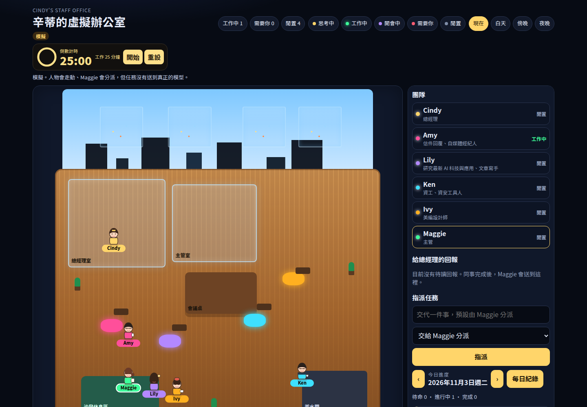
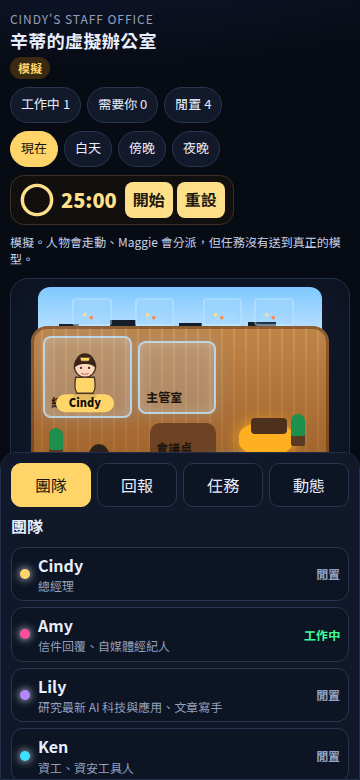

<p align="center">
  <a href="README_zh-CN.md">简体中文</a> ·
  <a href="README_zh-TW.md">繁體中文</a> ·
  <a href="README.md">English</a> ·
  <a href="README_ja.md">日本語</a>
</p>

## 辛蒂的 AI 同事辦公室

深色等距辦公室：Cindy 在玻璃總經理室，Maggie 是主管。任務預設交給 Maggie 分派；同事完成後會走到主管室，再由 Maggie 送到「給總經理的回報」。人物走動在沒接上模型時標成模擬。狀態（待命 / 進行中 / 完成）、每日紀錄和 25:00 番茄鐘都還在。手機上場景會縮小，側欄變成底部頁籤。原本的像素辦公室在 `pixel.html`。





### 本地執行

需要 Node.js 22 與 Python 3.11+。沒有 Docker、也沒有 API Key 就能用。

```bash
python3 -m venv .venv && source .venv/bin/activate
pip install -r requirements.txt
uvicorn app.main:app --reload --port 8001
```

另一個終端機：

```bash
cd frontend
npm install
npm run dev
```

打開 <http://localhost:5174/static/office/>。後端有開時，任務寫進 `data/cindy_office.json`，重新整理還在。

只想先看畫面、不啟 Python 也可以。這樣任務存在這台瀏覽器：

```bash
cd frontend && npm install && npm run build
npx vite preview --host 127.0.0.1 --port 4173
```

打開 <http://127.0.0.1:4173/>。手機請用同一個網址，或把視窗縮到約 360px。每位同事的房間都有輸入框；「跟同事說話」會打開對話。

### 任務有沒有送到真正的 Agent

**預設沒有。** 靜態網站只把任務和對話存在訪客自己的瀏覽器。本機若只開了後端、沒填模型，任務寫進 JSON 檔，並回一段固定的繁體中文確認，狀態維持待命，要自己改成進行中或完成。

要接到這個倉庫原本的 Agent 執行器（`app.services.agents.runner.run_agent`），需要同時：

1. 跑 FastAPI，不能只用 GitHub Pages 或 Vercel 的靜態檔。
2. 在 `.env` 設定 `DEFAULT_LLM_MODEL`（例如 `gemini/gemini-2.5-flash`）。
3. 設定對應的一把金鑰：`GEMINI_API_KEY`、`OPENAI_API_KEY`、`ANTHROPIC_API_KEY`、`DEEPSEEK_API_KEY` 或 `DASHSCOPE_API_KEY`。
4. 前端必須打得到同一個網域的 `/api/v1/office/cindy`。`npm run dev` 會把 `/api` 代理到 8001。靜態網站預設連不到後端，所以不會送出。

接上之後，指派或聊天會用該同事的系統提示詞呼叫模型，回覆出現在對話裡，任務改成完成。若資料庫有開、而且這位同事在原本的設定面板有自己的模型與金鑰，會優先用那一組。

接點：

- 後端：`app/office/cindy/adapter.py` 的 `AgentWorkAdapter`。沒有模型時用 `LocalEchoAdapter`，有模型時用 `OfficeRuntimeAdapter`。
- 前端：`frontend/src/cindy/backend.ts` 的 `OfficeBackend`。靜態網站用 `BrowserOfficeBackend`，偵測到 API 才用 `ServerOfficeBackend`。

### 部署到 Vercel 或 GitHub Pages

這是靜態網站，上面沒有登入，也沒有模型。不要在 Vercel 環境變數放 API Key。

**Vercel**

1. 把倉庫推上 GitHub，到 [vercel.com](https://vercel.com) 用 GitHub 登入後 Import。
2. Root Directory 留空（不要設成 `frontend`）。
3. 倉庫裡的 `vercel.json` 已寫好建置指令與輸出目錄 `app/static/office`。Framework Preset 選 Other。
4. 不要新增任何 API Key。按 Deploy。

**GitHub Pages**

1. 倉庫已有 `.github/workflows/pages.yml`。
2. GitHub → Settings → Pages → Build and deployment → Source 選 **GitHub Actions**。
3. 推上 `main` 後，Actions 會部署。網址會是 `https://<帳號>.github.io/AgentsOffice/`。
4. 私人倉庫在免費方案可能無法使用 Pages，需要改成公開。

### 公開網站的隱私

- 預設沒有帳號。每個人的任務只在自己的瀏覽器，換電腦或清除網站資料就沒了，別人也看不到。
- 請不要在任務或對話輸入密碼、金鑰、身分證、客戶資料或未公開的內容。
- 不要把 LLM API Key 打進前端。靜態檔任何人都能看。
- 這個 API **沒有登入**。不要把 FastAPI 直接公開到網路上：任何人都能讀寫任務；若伺服器上有模型金鑰，別人還能消耗額度。若要公開後端，請先加上登入（反向代理、Vercel 密碼保護，或只放在私人網路）。`CINDY_CORS_ORIGINS` 預設關閉，不要設成 `*`。

---

<p align="center">
  
</p>

<h1 align="center">AgentsOffice</h1>

<p align="center">
  <strong>A visible office for your AI team</strong>
</p>

<p align="center">
  <a href="https://github.com/DBell-workshop/agents-office/stargazers"></a>
  <a href="https://github.com/DBell-workshop/agents-office/blob/main/LICENSE"></a>
  <a href="#"></a>
  <a href="#"></a>
</p>

<p align="center">
  <a href="#use-cases">Use Cases</a> ·
  <a href="#features">Features</a> ·
  <a href="#quick-start">Quick Start</a> ·
  <a href="#architecture">Architecture</a> ·
  <a href="#support">Support Us</a> ·
  <a href="LICENSE">License</a>
</p>

---

## What is AgentsOffice?

AgentsOffice is a **multi-agent collaboration workbench** that brings your AI team to life in a pixel-art RPG office.

Define roles, write prompts, equip skills -- spin up your own AI workforce in 5 minutes.

> **Unlike other "pixel office" projects, our agents don't just wander around looking cute. They actually get work done.**

| Other Projects | AgentsOffice |
|---------|-------------|
| Visual dashboards that display agent status | **Full-featured AI workbench** with real agent skills |
| Requires external AI tools to function | **Built-in LLM chat + Skill engine**, works out of the box |
| Single-role showcase | **Multi-role collaboration** with a dispatcher that auto-assigns tasks |
| View-only | **Chat, trigger skills, and analyze data** |

---

<a id="use-cases"></a>
## Use Cases -- Define the roles, build your team

> Here are some real-world scenarios you can set up in 5 minutes.

### 📝 Content Creator Studio
> Running a one-person media operation? Give yourself a content team.

**Topic Planner** tracks trends and finds angles + **Content Editor** drafts and revises + **Headline Expert** generates 10 title options for you to pick from. Open the office each morning, drop your topic ideas into the group chat, and the three agents divide the work automatically -- you just make the final call.

### 🎯 Product Design Team
> Research, competitive analysis, PRD -- stop being the "human middleware."

**User Researcher** organizes feedback and distills requirements + **Competitive Analyst** breaks down competitor features and strategies + **PRD Assistant** auto-generates requirement documents. Insights flow between agents automatically -- no more copy-pasting.

### 📚 Education Tutoring Hub
> Give students their own AI teaching team.

**Knowledge Explainer** breaks down concepts in plain language + **Quiz Coach** generates practice problems matched to skill level + **Study Planner** adjusts review schedules based on mistakes. AI tutors in a pixel classroom -- learning with a sense of immersion.

### 🎧 Customer Service Training Camp
> Onboard new reps without tying up your senior staff.

**Simulated Customer** role-plays as various buyer personas + **QA Supervisor** evaluates and scores each response in real time + **Script Coach** offers improvement tips after every round. A training-evaluation-improvement loop available 24/7.

### 💡 Startup Advisory Board
> Can't afford a consulting firm? Assemble an AI advisory team.

**Market Analyst** researches industry trends + **Business Advisor** maps out monetization paths + **Growth Specialist** designs customer acquisition strategies. Drop your business plan into the group chat and get feedback from three advisors with different perspectives -- for less than the price of a dinner out each month.

### 💻 Indie Developer Studio
> Let AI teammates handle everything outside of coding.

**Product Assistant** organizes requirements and writes user stories + **Code Reviewer** reviews code and finds bugs + **Marketing Copywriter** writes release notes and promotional copy. You focus on writing code; leave the rest to the team.

---

| Scenario | Core Value | Agents |
|------|---------|-----------|
| Content Studio | One person, triple the output | 3 |
| Product Design | Automated research-to-doc pipeline | 3 |
| Education Tutoring | AI teaching team | 3 |
| CS Training | Train-evaluate-improve loop | 3 |
| Startup Advisory | Affordable consulting team | 3 |
| Indie Dev | Full coverage beyond code | 3 |

**Have your own scenario in mind?** Open AgentsOffice, create your agents, write your prompts, and get to work.

---

<a id="features"></a>
## Features

### 🏢 Pixel-Art RPG Office
Built on the Phaser 3 game engine -- a 2D pixel office where every agent has their own desk, room, and animations. Click an agent to start a conversation.

### 🤖 Flexible Agent System
- **Unlimited agents**: Create as many agents as you need to build your dream team
- **Configurable via UI**: Name, prompt, model, skills -- no code changes needed
- **20 pre-made pixel characters** to choose from, giving each agent a unique look

### 💬 Smart Conversations
- **Group chat**: The dispatcher auto-detects intent and routes to the right agent
- **Direct messages**: One-on-one deep conversations with a specific agent
- **Auto-triggered skills**: Agents automatically execute skills when the context calls for it

### 🔌 Skill Plugin System
- Extend `BaseSkill` to build custom skills
- Skills support multi-step interactions (search -> select -> analyze)
- SSE real-time progress streaming

### 🗄️ Data Management
- The Data Engineer agent helps you upload CSVs, create tables, and query data
- PostgreSQL persistence with flexible JSONB fields
- Connect to external databases

### 🧮 Cost Tracking
- Every LLM call is logged with token usage and cost
- View cost reports by agent or by model
- Built-in pricing for popular models (OpenAI, Claude, Gemini, DeepSeek)

---

<a id="quick-start"></a>
## Quick Start

### One-Click Launch (Recommended)

Just install [Docker](https://www.docker.com/products/docker-desktop/), then:

```bash
git clone https://github.com/DBell-workshop/agents-office.git
cd agents-office
cp .env.example .env   # Edit .env, add at least one LLM API Key
docker compose up -d
```

Open **http://localhost:8001/static/office/** and you're good to go.

### Development Mode

If you want to modify code (with hot reload):

```bash
# Database
docker compose up postgres -d

# Backend
python3 -m venv .venv && source .venv/bin/activate
pip install -r requirements.txt
uvicorn app.main:app --reload --port 8001

# Frontend (separate terminal)
cd frontend && npm install && npm run dev
```

Dev mode: visit **http://localhost:5174/static/office/**

---

<a id="architecture"></a>
## Architecture

```
┌─────────────────────────────────────────────┐
│                  Frontend                    │
│  Phaser RPG Engine + React Overlay + ChatBox │
│  (Pixel Office + Agent Panel + Chat Dialog)  │
└────────────────────┬────────────────────────┘
                     │ SSE / REST
┌────────────────────▼────────────────────────┐
│              FastAPI Backend                  │
│                                              │
│  ┌──────────┐  ┌──────────┐  ┌───────────┐  │
│  │ AgentChat │  │  Skills  │  │  Data     │  │
│  │ (Dispatch │  │  Engine  │  │  Manager  │  │
│  │  & DM)   │  │          │  │           │  │
│  └─────┬────┘  └─────┬────┘  └─────┬─────┘  │
│        │             │             │         │
│  ┌─────▼─────────────▼─────────────▼──────┐  │
│  │           Service Layer                 │  │
│  │  LLM Service / Agent Runner             │  │
│  │  Skill Engine / Cost Tracker            │  │
│  └─────────────────┬──────────────────────┘  │
│                    │                         │
│  ┌─────────────────▼──────────────────────┐  │
│  │         PostgreSQL + SQLAlchemy         │  │
│  │    Agents / Skills / Tasks / Costs      │  │
│  └────────────────────────────────────────┘  │
└──────────────────────────────────────────────┘
```

**Tech Stack:**
- **Backend**: Python, FastAPI, SQLAlchemy, Pydantic
- **Frontend**: TypeScript, React, Phaser 3 (RPG engine)
- **AI**: LLM via OpenAI-compatible API (GPT, Claude, Gemini, Qwen, DeepSeek)
- **Database**: PostgreSQL with JSONB
- **Infra**: Docker Compose

---

<a id="support"></a>
## Support This Project

AgentsOffice is a community-driven open source project. If you find it useful, please consider supporting us:

<p align="center">

**⭐ [Star this repo](https://github.com/DBell-workshop/agents-office)** — The simplest way to support us

**💳 PayPal** — Scan to support us<br/>


</p>

> Every Star and sponsorship keeps us going!

---

## Roadmap

- [x] Pixel-art RPG office UI
- [x] Dynamic agent configuration (UI panel)
- [x] Group chat dispatch & direct messages
- [x] Skill plugin engine
- [x] Data Engineer (file upload, table creation, SQL queries)
- [x] LLM cost tracking
- [ ] More pre-built skill templates
- [ ] Agent state animations (working -> typing on keyboard, idle -> sipping coffee)
- [ ] Mobile-responsive layout
- [ ] Token top-up & usage management
- [ ] Skill marketplace (community sharing)

---

## Community

Join the community to share ideas, ask questions, and show off your agent setups:

<p align="center">
  <a href="https://discord.gg/3Cpe5H6m"></a>
</p>

<p align="center">
  <strong>WeChat Group</strong> (scan to join; after 7-day expiry, get the latest QR in Discussions)<br/>
  
</p>

---

## Contributing

Contributions are welcome!

- Open an Issue to report bugs or suggest features
- Submit a PR to contribute code
- Build custom skills and share them with the community
- Chat with us on [Discussions](https://github.com/DBell-workshop/agents-office/discussions)

---

## License

This project is licensed under the [Business Source License 1.1](LICENSE).

- ✅ Personal use, learning, research, and internal evaluation
- ❌ Commercial use requires authorization
- 📅 Automatically converts to Apache 2.0 in 2030

See the [LICENSE](LICENSE) file for details.

---

<p align="center">
  <sub>Built with ❤️ by the AgentsOffice Team</sub>
</p>
