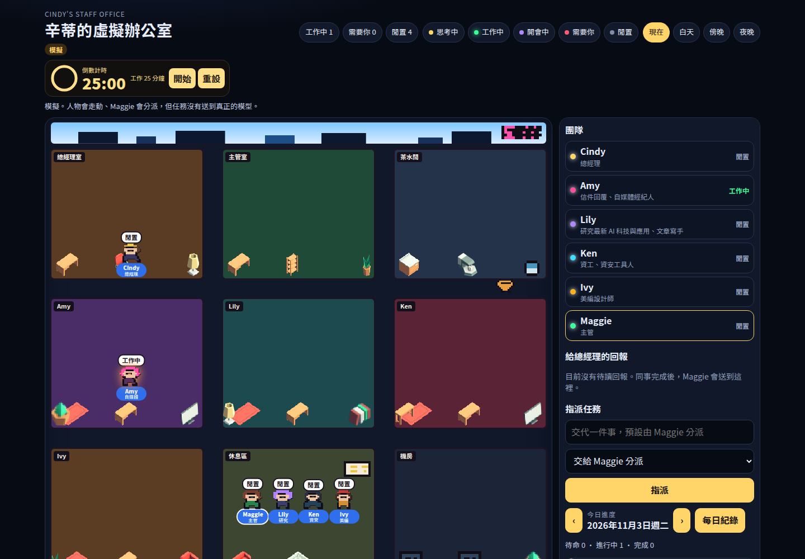
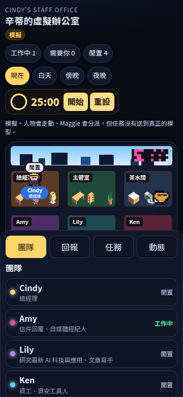

<p align="center">
  <a href="README_zh-CN.md">简体中文</a> ·
  <a href="README_zh-TW.md">繁體中文</a> ·
  <a href="README.md">English</a> ·
  <a href="README_ja.md">日本語</a>
</p>

## 辛蒂的 AI 同事辦公室

家具圖來自 [Kenney Furniture Kit](https://kenney.nl/assets/furniture-kit)（CC0），縮小成像素比例後放進房間。角色、辦公室貓、霓虹燈、白板和機櫃是這個專案自己畫的像素圖。

深色等距辦公室：Cindy 在玻璃總經理室，Maggie 是主管。任務預設交給 Maggie 分派；同事完成後會走到主管室，再由 Maggie 送到「給總經理的回報」。人物走動在沒接上模型時標成模擬。狀態（待命 / 進行中 / 完成）、每日紀錄和 25:00 番茄鐘都還在。手機上場景會縮小，側欄變成底部頁籤。原本的像素辦公室在 `pixel.html`。





### 本地執行

需要 Node.js 22 與 Python 3.11+。沒有 Docker、也沒有 API Key 就能用。

```bash
python3 -m venv .venv && source .venv/bin/activate
pip install -r requirements.txt
uvicorn app.main:app --reload --port 8001
```

另一個終端機：

```bash
cd frontend
npm install
npm run dev
```

打開 <http://localhost:5174/static/office/>。後端有開時，任務寫進 `data/cindy_office.json`，重新整理還在。

只想先看畫面、不啟 Python 也可以。這樣任務存在這台瀏覽器：

```bash
cd frontend && npm install && npm run build
npx vite preview --host 127.0.0.1 --port 4173
```

打開 <http://127.0.0.1:4173/>。手機請用同一個網址，或把視窗縮到約 360px。每位同事的房間都有輸入框；「跟同事說話」會打開對話。

### 任務有沒有送到真正的 Agent

**預設沒有。** 靜態網站只把任務和對話存在訪客自己的瀏覽器。本機若只開了後端、沒填模型，任務寫進 JSON 檔，並回一段固定的繁體中文確認，狀態維持待命，要自己改成進行中或完成。

要接到這個倉庫原本的 Agent 執行器（`app.services.agents.runner.run_agent`），需要同時：

1. 跑 FastAPI，不能只用 GitHub Pages 或 Vercel 的靜態檔。
2. 在 `.env` 設定 `DEFAULT_LLM_MODEL`（例如 `gemini/gemini-2.5-flash`）。
3. 設定對應的一把金鑰：`GEMINI_API_KEY`、`OPENAI_API_KEY`、`ANTHROPIC_API_KEY`、`DEEPSEEK_API_KEY` 或 `DASHSCOPE_API_KEY`。
4. 前端必須打得到同一個網域的 `/api/v1/office/cindy`。`npm run dev` 會把 `/api` 代理到 8001。靜態網站預設連不到後端，所以不會送出。

接上之後，指派或聊天會用該同事的系統提示詞呼叫模型，回覆出現在對話裡，任務改成完成。若資料庫有開、而且這位同事在原本的設定面板有自己的模型與金鑰，會優先用那一組。

接點：

- 後端：`app/office/cindy/adapter.py` 的 `AgentWorkAdapter`。沒有模型時用 `LocalEchoAdapter`，有模型時用 `OfficeRuntimeAdapter`。
- 前端：`frontend/src/cindy/backend.ts` 的 `OfficeBackend`。靜態網站用 `BrowserOfficeBackend`，偵測到 API 才用 `ServerOfficeBackend`。

### 部署到 Vercel 或 GitHub Pages

這是靜態網站，上面沒有登入，也沒有模型。不要在 Vercel 環境變數放 API Key。

**Vercel**

1. 把倉庫推上 GitHub，到 [vercel.com](https://vercel.com) 用 GitHub 登入後 Import。
2. Root Directory 留空（不要設成 `frontend`）。
3. 倉庫裡的 `vercel.json` 已寫好建置指令與輸出目錄 `app/static/office`。Framework Preset 選 Other。
4. 不要新增任何 API Key。按 Deploy。

**GitHub Pages**

1. 倉庫已有 `.github/workflows/pages.yml`。
2. GitHub → Settings → Pages → Build and deployment → Source 選 **GitHub Actions**。
3. 推上 `main` 後，Actions 會部署。網址會是 `https://<帳號>.github.io/AgentsOffice/`。
4. 私人倉庫在免費方案可能無法使用 Pages，需要改成公開。

### 公開網站的隱私

- 預設沒有帳號。每個人的任務只在自己的瀏覽器，換電腦或清除網站資料就沒了，別人也看不到。
- 請不要在任務或對話輸入密碼、金鑰、身分證、客戶資料或未公開的內容。
- 不要把 LLM API Key 打進前端。靜態檔任何人都能看。
- 這個 API **沒有登入**。不要把 FastAPI 直接公開到網路上：任何人都能讀寫任務；若伺服器上有模型金鑰，別人還能消耗額度。若要公開後端，請先加上登入（反向代理、Vercel 密碼保護，或只放在私人網路）。`CINDY_CORS_ORIGINS` 預設關閉，不要設成 `*`。

---

<p align="center">
  
</p>

<h1 align="center">AgentsOffice</h1>

<p align="center">
  <strong>給你的 AI 團隊一間看得見的辦公室</strong>
</p>

<p align="center">
  <a href="https://github.com/DBell-workshop/agents-office/stargazers"></a>
  <a href="https://github.com/DBell-workshop/agents-office/blob/main/LICENSE"></a>
  <a href="#"></a>
  <a href="#"></a>
</p>

<p align="center">
  <a href="#use-cases">應用場景</a> ·
  <a href="#features">功能</a> ·
  <a href="#quick-start">快速開始</a> ·
  <a href="#architecture">架構</a> ·
  <a href="#support">支持我們</a> ·
  <a href="LICENSE">License</a>
</p>

---

## What is AgentsOffice?

AgentsOffice 是一個**多 Agent 協作工作台**，用像素風 RPG 辦公室讓你的 AI 團隊「可視化地上班」。

你定義角色、寫提示詞、裝載技能，5 分鐘就能搭建一個屬於你的 AI 數位員工團隊。

> **和其他「像素辦公室」專案不同：我們的 Agent 不只是會走來走去的小人，它們真的在幹活。**

| 其他專案 | AgentsOffice |
|---------|-------------|
| 純視覺化看板，展示 Agent 狀態 | **完整的 AI 工作台**，Agent 有真實技能 |
| 需要外接其他 AI 工具才能工作 | **自帶 LLM 對話 + Skill 引擎**，開箱即用 |
| 單角色展示 | **多角色協作**，調度員自動分配任務 |
| 只能看 | **能聊天、能觸發技能、能分析資料** |

---

<a id="use-cases"></a>
## Use Cases — 不限行業，你定義角色就是你的團隊

> 以下是一些真實應用場景，5 分鐘就能配好。

### 📝 自媒體內容工坊
> 一個人做號？給自己配個內容團隊。

**選題策劃師** 追熱點找選題 + **內容編輯** 寫初稿改稿 + **標題專家** 生成10個標題供你選。每天打開辦公室，把想寫的方向丟進群聊，三個員工自動分工，你只管最後拍板。

### 🎯 產品設計團隊
> 調研、競品、PRD，不再當「人肉中介軟體」。

**使用者研究員** 整理回饋歸納需求 + **競品分析師** 拆解競品功能策略 + **PRD 助手** 自動產生需求文件。分析結論自動流轉，不用複製貼上。

### 📚 教育輔導站
> 給學生配一個 AI 教學團隊。

**知識講解員** 用通俗語言講概念 + **出題教練** 根據水平出練習題 + **學習規劃師** 根據錯題調整複習計畫。像素教室裡的 AI 老師，學習儀式感拉滿。

### 🎧 客服訓練營
> 新人培訓，不用老員工帶。

**模擬顧客** 扮演各種買家 + **質檢主管** 即時評估回覆打分 + **話術教練** 每輪對話給改進建議。訓練-評估-改進閉環，7x24 小時可練。

### 💡 創業智囊團
> 請不起諮詢公司？配個 AI 顧問團。

**市場分析師** 研究行業趨勢 + **商業顧問** 梳理獲利路徑 + **成長專家** 設計獲客策略。把商業計畫書丟進群聊，三個顧問從不同角度給你回饋。每月不到一頓火鍋的錢。

### 💻 獨立開發者工作室
> 技術之外的活，交給 AI 同事。

**產品助手** 梳理需求寫使用者故事 + **程式碼審查員** review 程式碼找 bug + **營運文案** 寫發佈日誌和推廣文案。你專注寫程式，其餘交給團隊。

---

| 場景 | 核心價值 | Agent 數量 |
|------|---------|-----------|
| 自媒體工坊 | 一人產出三人效率 | 3 |
| 產品設計 | 調研到文件自動流轉 | 3 |
| 教育輔導 | AI 教學團隊 | 3 |
| 客服訓練 | 訓練-評估-改進閉環 | 3 |
| 創業智囊 | 平價諮詢團隊 | 3 |
| 獨立開發 | 技術之外全覆蓋 | 3 |

**想到了自己的場景？** 打開 AgentsOffice，建立你的 Agent，寫上提示詞，就能開工。

---

<a id="features"></a>
## Features

### 🏢 像素風 RPG 辦公室
基於 Phaser 3 遊戲引擎建構的 2D 像素辦公室。每個 Agent 有自己的工位、房間和動畫。點擊 Agent 就能和它對話。

### 🤖 靈活的 Agent 系統
- **不限數量**：自由建立任意多個 Agent，打造你的專屬團隊
- **透過 UI 設定**：角色名、提示詞、模型、技能，不用改程式碼
- **20 個預製像素角色**可選，每個 Agent 都有獨立形象

### 💬 智慧對話
- **群聊模式**：調度員自動識別意圖，分配給合適的 Agent
- **私聊模式**：直接和特定 Agent 一對一深入交流
- **Skill 自動觸發**：Agent 識別到需要技能時自動執行

### 🔌 Skill 外掛系統
- 繼承 `BaseSkill` 即可開發自訂技能
- Skill 支援多步互動（搜尋 → 選擇 → 分析）
- SSE 即時推送執行進度

### 🗄️ 資料管理
- 資料工程師 Agent 可幫你上傳 CSV、建表、查詢資料
- PostgreSQL 持久化，JSONB 彈性欄位
- 支援連接外部資料庫

### 🧮 成本追蹤
- 每次 LLM 呼叫自動記錄 Token 用量和費用
- 按 Agent / 按模型維度檢視成本報表
- 內建主流模型定價（OpenAI、Claude、Gemini、DeepSeek）

---

<a id="quick-start"></a>
## Quick Start

### 一鍵啟動（推薦）

只需要安裝 [Docker](https://www.docker.com/products/docker-desktop/)，然後：

```bash
git clone https://github.com/DBell-workshop/agents-office.git
cd agents-office
cp .env.example .env   # 編輯 .env，至少填入一個 LLM API Key
docker compose up -d
```

打開 **http://localhost:8001/static/office/** 即可使用。

### 開發模式

如果你想修改程式碼（支援熱更新）：

```bash
# 資料庫
docker compose up postgres -d

# 後端
python3 -m venv .venv && source .venv/bin/activate
pip install -r requirements.txt
uvicorn app.main:app --reload --port 8001

# 前端（另一個終端）
cd frontend && npm install && npm run dev
```

開發模式訪問 **http://localhost:5174/static/office/**

---

<a id="architecture"></a>
## Architecture

```
┌─────────────────────────────────────────────┐
│                  Frontend                    │
│  Phaser RPG Engine + React Overlay + ChatBox │
│  (像素辦公室 + Agent面板 + 對話框)             │
└────────────────────┬────────────────────────┘
                     │ SSE / REST
┌────────────────────▼────────────────────────┐
│              FastAPI Backend                  │
│                                              │
│  ┌──────────┐  ┌──────────┐  ┌───────────┐  │
│  │ AgentChat │  │  Skills  │  │  Data     │  │
│  │ (調度/私聊)│  │  Engine  │  │  Manager  │  │
│  └─────┬────┘  └─────┬────┘  └─────┬─────┘  │
│        │             │             │         │
│  ┌─────▼─────────────▼─────────────▼──────┐  │
│  │           Service Layer                 │  │
│  │  LLM Service / Agent Runner             │  │
│  │  Skill Engine / Cost Tracker            │  │
│  └─────────────────┬──────────────────────┘  │
│                    │                         │
│  ┌─────────────────▼──────────────────────┐  │
│  │         PostgreSQL + SQLAlchemy         │  │
│  │    Agents / Skills / Tasks / Costs      │  │
│  └────────────────────────────────────────┘  │
└──────────────────────────────────────────────┘
```

**Tech Stack:**
- **Backend**: Python, FastAPI, SQLAlchemy, Pydantic
- **Frontend**: TypeScript, React, Phaser 3 (RPG engine)
- **AI**: LLM via OpenAI-compatible API (GPT, Claude, Gemini, Qwen, DeepSeek)
- **Database**: PostgreSQL with JSONB
- **Infra**: Docker Compose

---

<a id="support"></a>
## 支持這個專案

AgentsOffice 是一個由社群驅動的開源專案。如果覺得有幫助，請考慮支持我們：

<p align="center">

**⭐ [Star 這個 Repo](https://github.com/DBell-workshop/agents-office)** — 最簡單的支持方式

**☕ [Buy Me a Coffee](https://buymeacoffee.com/)** — 請我們喝杯咖啡

**💖 [GitHub Sponsors](https://github.com/sponsors/DBell-workshop)** — 成為長期贊助者

**🎁 [Ko-fi](https://ko-fi.com/)** — 一次性打賞

</p>

> 你的每一個 Star 和贊助都是我們持續開發的動力！

---

## Roadmap

- [x] 像素風 RPG 辦公室介面
- [x] Agent 動態設定（UI 面板）
- [x] 群聊調度 & 私聊對話
- [x] Skill 外掛引擎
- [x] 資料工程師（檔案上傳、建表、SQL查詢）
- [x] LLM 成本追蹤
- [ ] 更多預製 Skill 範本
- [ ] Agent 狀態動畫（工作 → 敲鍵盤，閒置 → 喝咖啡）
- [ ] 行動端適配
- [ ] Token 儲值 & 用量管理
- [ ] Skill 市場（社群共享）

---

## Community

加入社群，交流想法、提問、分享你的 Agent 配置：

<p align="center">
  <a href="https://discord.gg/3Cpe5H6m"></a>
</p>

<p align="center">
  <strong>微信群</strong>（掃碼加入，7天有效期後請到 Discussions 取得最新二維碼）<br/>
  
</p>

---

## Contributing

歡迎貢獻！

- 提交 Issue 回報 Bug 或建議功能
- 提交 PR 貢獻程式碼
- 開發自訂 Skill 並分享給社群
- 在 [Discussions](https://github.com/DBell-workshop/agents-office/discussions) 交流想法

---

## License

本專案採用 [Business Source License 1.1](LICENSE)。

- ✅ 個人使用、學習、研究、內部評估
- ❌ 未經授權不得商業化使用
- 📅 2030 年自動轉為 Apache 2.0 開源

詳見 [LICENSE](LICENSE) 檔案。

---

<p align="center">
  <sub>Built with ❤️ by the AgentsOffice Team</sub>
</p>
